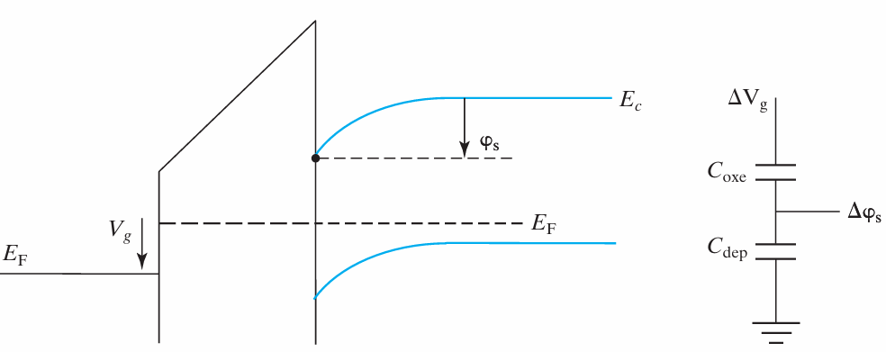
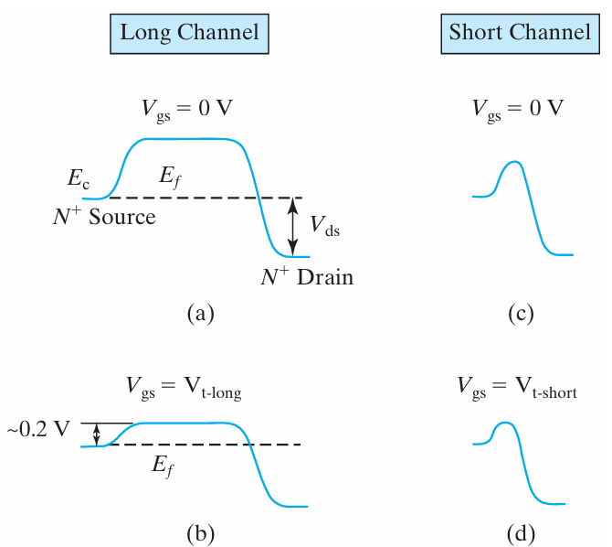
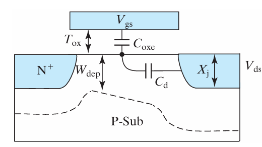
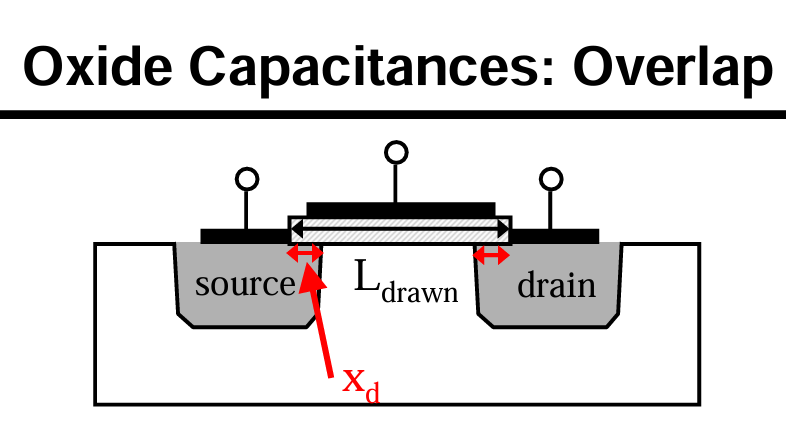

# technology scaling
- -> `line width` -> `more transistors on a wafer` -> `cost drop`
- -> `gate oxide thickness reduced` -> `smaller capacitance -> higher speed` -> `wide band data transmission via RF`
- -> `lowering power supply voltage` -> `reduce consumption`

## strained silicon
hole surface mobility of a PFET can be raised when the channel is stressed. Ge has higher carrier mobility than Si.

## subthreshold current
>$I_{on}$ increase leads to circuit speed improvements, so small $V_t$ is desirable. The former chapter discussed the current in on-state of MOSFET. Now we are to discover the current at the opposite state, then we may realise that $V_t$ must not be too small.
- Definition
The MOSFET current **observed** at $V_{gs} < V_t$ is called `subthreshold current` or `off-state current`. It is important to keep it small to minimize static power consumption in standby mode.

|||
|---|---|
||the inversion electron concentration is small but allow a small leakage current|

The capacitor model can be reused. However, $η \neq m$ due to the change of oxide thickness.
Check [voltage reference definition]() in former chapters.
$$\frac{\mathrm{d}\varphi_s}{\mathrm{d}V_{\mathrm{gs}}} = \frac{C_{\mathrm{oxe}}}{C_{\mathrm{oxe}} + C_{\mathrm{dep}}} \equiv \frac{1}{\eta}$$

$$\eta = 1 + \frac{C_{\mathrm{dep}}}{C_{\mathrm{oxe}}}$$

$$\varphi_s = \text{constant} + V_g / \eta$$

$$I_{\mathrm{ds}} \propto n_s \propto e^{q\varphi_s / kT} \propto e^{qV_g / \eta kT}$$
A **practical and common definition** of $V_t$ is the $V_{gs}$ at which $I_{ds}=100nA × W/L$
$$I_{\mathrm{ds}}(\mathrm{nA}) = 100 \cdot \frac{W}{L} \cdot e^{q(V_{\mathrm{gs}} - V_t) / \eta kT}$$
At **room temperature ( $T = 300K$ )**, the function $exp(qV_{gs}/ηkT)$ changes by 10 for every 60mV change in $V_{gs}$, therefore $exp(qV_{gs}/kT)$ changes by 10 for every η × 60mV. η×60 mV is called the `subthreshold swing` and represented by the symbol, $S$.
$$S(\mathrm{mV/decade}) = \frac{\text{d}V_{gs}}{\text{d} log_{10} I_{ds}} = \eta \cdot 60 \ \mathrm{mV} \cdot \frac{T}{300\mathrm{K}}$$
Remember, such definition is based on **Boltzman approximation**.

$$I_{\mathrm{ds}}(\mathrm{nA}) = 100 \cdot \frac{W}{L} \cdot e^{q(V_{\mathrm{gs}} - V_t) / \eta kT} = 100 \cdot \frac{W}{L} \cdot 10^{(V_{\mathrm{gs}} - V_t) / S}$$

$$I_{\mathrm{off}}(\mathrm{nA}) = 100 \cdot \frac{W}{L} \cdot e^{-qV_t / \eta kT} = 100 \cdot \frac{W}{L} \cdot 10^{-V_t / S}$$
$V_t$ must not be too small, otherwise the off-state current is unbearable. To decrease `subthreshold swing`, we can decrease $T_{ox}$ or increase $W_{dep}$.

## short channel effect
>Miniturization makes the `channel length` way shorter than before. `channel length` $L$ cannot be measured precisely, but tracks `gate length` $L_g$ (the difference btw $L, L_g$ cannot be quantified). This section presents that $L$ must not be too short.

Here is an off-state scenario: 
$$V_{gs} = 0 \qquad V_{ds} \approx V_{dsat} \;or\; higher$$
Check [saturation region of MOSFET]()
|||
|---|---|
|| The barrier is flattened, this is called short channel **$V_t$ roll off**.|

$Q_{inv} = 0$ near drain side. As the `channel length` is reduced, the drain to "channel" distance is reduced. Therefore, the inversion layer or channel near drain behaves like a capacitor, denoted as $C_d$.

|||
|---|---|
||$$V_t = V_{t-long} - (V_{ds} + 0.4 \text{V})\frac{C_d}{C_{oxe}}$$ Revised by `Poisson equation`: $$V_t = V_{t-long} - (V_{ds} + 0.4 \text{V})e^{-L/l_d}$$|

The concept that the drain can lower the source–channel barrier and reduce $V_t$ is called `drain-induced barrier lowering` or **DIBL**. 
$$l_d \propto \sqrt[3]{T_{oxe}W_{dep} X_j} $$
$l_d$ may be called the `DIBL characteristic length`. 

### why capacitor?
In the [MOSFET carrier pinch off](), the carriers from channel can still travel through the `pinch-off region` near drain due to the **high electric field and current density**, at that time, this `pinch-off region` behaves like a conductor.

However, when the MOSFET is at off-state, the current density is insufficient, leading to no current density, which means that it's a **electrostatic problem**. There is no flowing carriers.

## Gate induced drain leakage
>Manufacturing thin oxide to raise circuit speed, and control $V_t$ roll off.
- oxide breakdown
- long-term operation at high field, high temperature 

breaks chemical bonds at Si-SiO2 interface, thus creating oxide charge and $V_t$ shift.
- tunneling leakage current
It's the most serious limiting factor for films thinner than 1.5 nm.
### solution
High-$k$ dielectric material to replace SiO2. **$k$ is equivalent to $\epsilon_r$ or $\kappa$ in physics.**  

# Mosfet Parasitic Capacitance
This chapter is based on [JordonEdmunds's](https://www.youtube.com/@JordanEdmundsEECS) courses.

Pictures are taken from [ucdavis lectures](https://www.ece.ucdavis.edu/~ramirtha/EEC118/S11/lecture2.pdf).
## Overlap capacitance
|||
|---|---|
||**Capacitance per unit area** $$C_{ov} = \frac{\epsilon_{ox}}{T_{ox}}$$|

$C_{gd}$ and $C_{gs}$ is determined by $C_{ox}$

## PN junction capacitance
>Reverse-biased P-N junctions. Capacitance depends on reverse-bias voltage.

Check [PN junction barrier capacitance]()

$$C = \frac{\epsilon_s}{W_{dep}} = \sqrt{\frac{q\epsilon_s}{2\epsilon V_{sb}}\frac{N_a N_d}{N_a + N_d}}$$
if $N_d \gg N_a$
$$C = \sqrt{\frac{q\epsilon_s}{2\epsilon V_{sb}}N_a}$$

## Gate capacitance
Discussed before, 
please check [here]()

The gate capacitance reaches its minimum when gate voltage approaches threshold.

