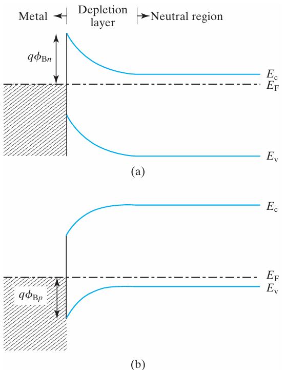
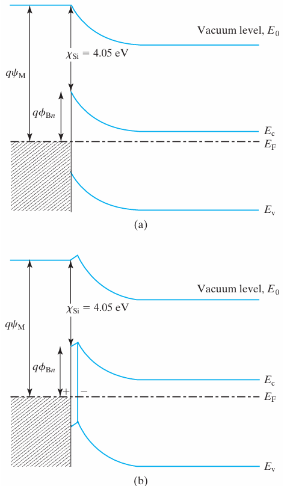
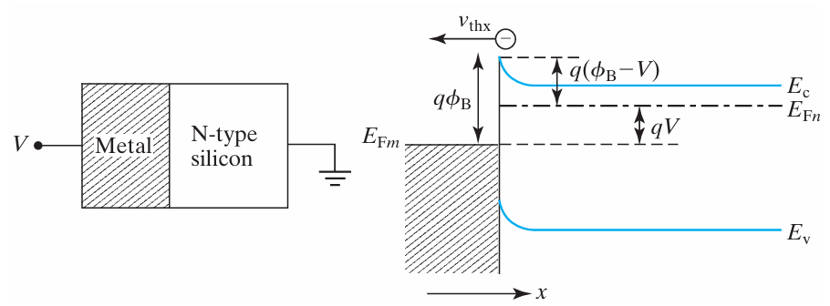
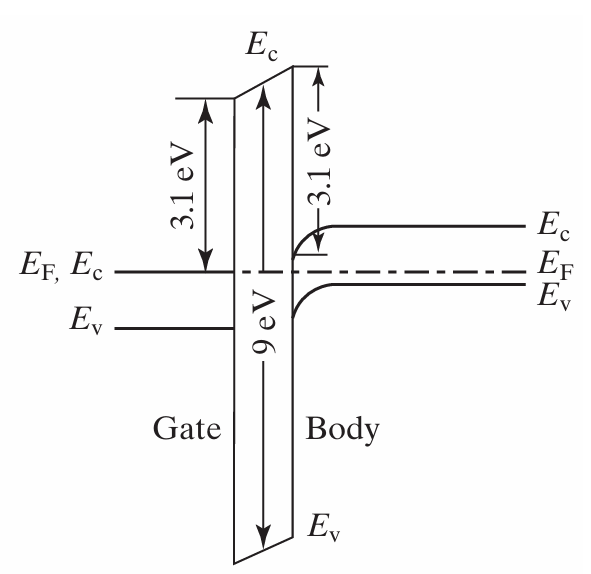
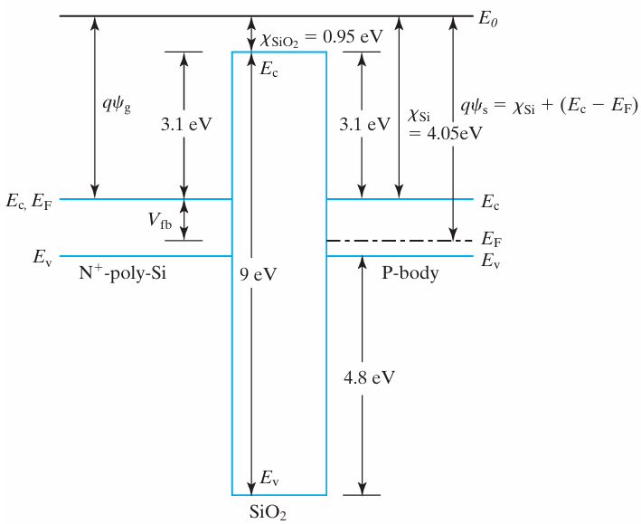
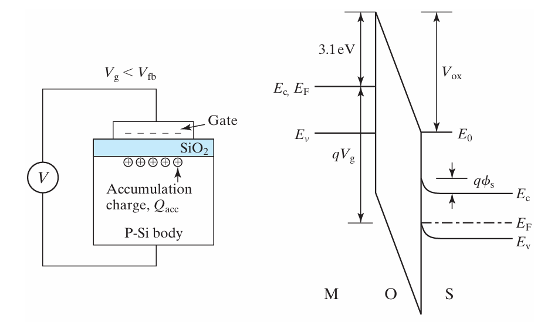
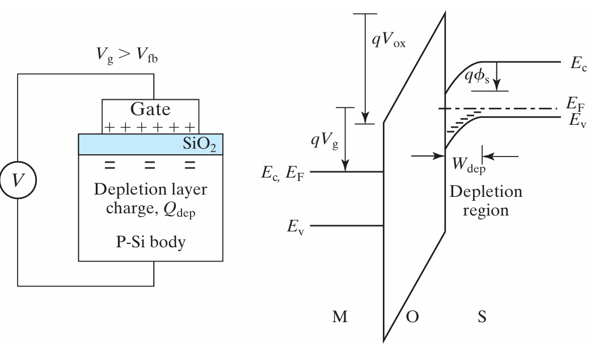
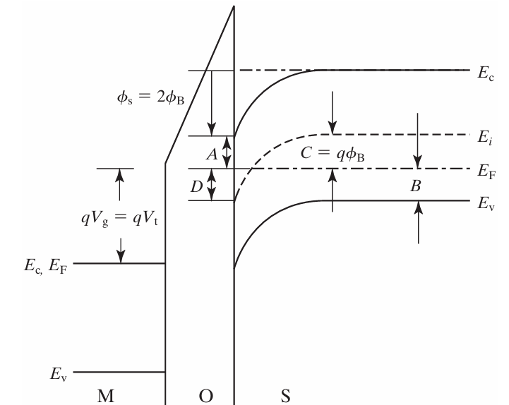
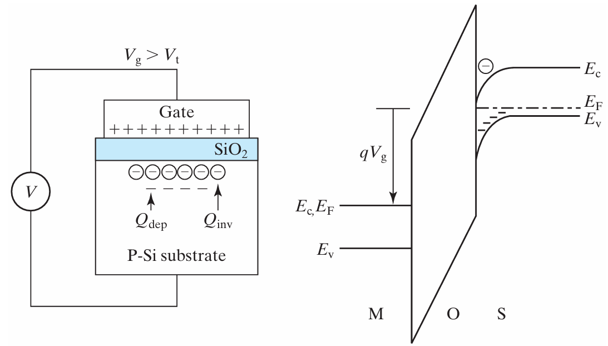
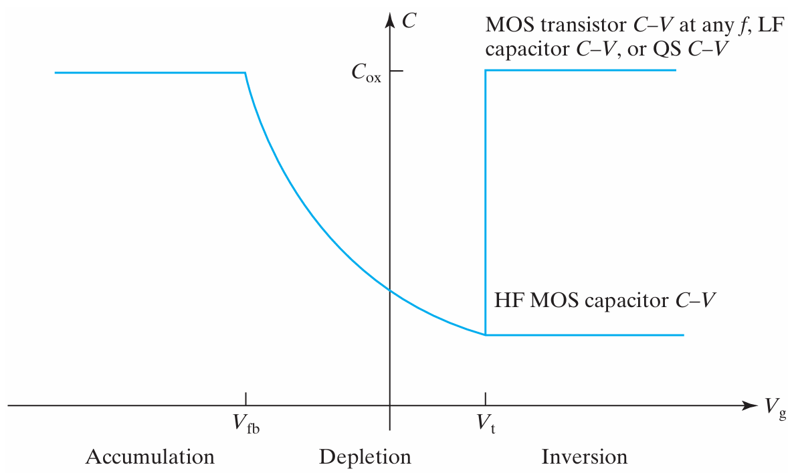

# metal-semiconductor junctions
|n type & p type | work function|
| --- | --- |
|||

接下来全部以**n-type semiconductor and high-work-function metal contact**为例子。
## 能量概念定义
### vaccum level
The energy level where electrons break free from solid lattice, into vaccum space. When applied voltage, the vaccum level bends, bcs electron's energy varies in different points of vaccum space.

### metal work function
$$\Phi_m = E_{vac} - E_{fm}$$

### silicon electron affinity
$$\chi_s = E_{vac} - E_c$$

### silicon work function
$$\Phi_s = E_{vac} - E_{fs} = \chi_s + E_c - E_{fs}$$

### Schottky barrier
- 在界面处，因为`silicon electron affinity`等保持固定，且`vaccum level`连续，（空间中同一点`vaccum level`左右极限相同）可以推断界面处的 $E_c$ 高于 $E_f$ 。The gap btw $E_c$ and $E_f$ is **defined** `Schottky barrier`.
$$\phi_{Bn} = E_c(界面) - E_{fm}$$
- `Schottky barrier` $\Phi_B$ is **determined** by `metal work function` and `silicon electron affinity`.
$$\phi_{Bn} = \Phi_m - \chi_s$$

## why depletion?
the **work function difference** between metals and semiconductors drives charge transfer and redistribution upon contact to reach thermal equilibrium.

1. **Fermi levels differ**: **Before contact**, $E_{Fs} > E_{Fm}$ (i.e., $\Phi_s < \Phi_m$), so semiconductor electrons have higher energy.

2. **Charge transfer**: **On contact**, Fermi levels align ($E_{Fs} = E_{Fm}$), so electrons diffuse from semiconductor to metal. Metal is an ocean of electrons, so the diffusing electrons are like a drop in the ocean.

3. **Depletion region forms**:
   - Electrons accumulate on the metal surface.
   - Donor impurities left behind become fixed positive ions ($N_D^+$).
   - With free electrons depleted, a **space charge/depletion region** forms near the interface.
   - For **p-type** with a low-work-function metal ($\Phi_m < \Phi_s$), holes flow to the metal, leaving negative acceptor ions ($N_A^-$) and a depletion region.

# thermionic emission theory

推导肖特基二极管在正向偏压 $V$ 下，流过界面的净电流密度 $J$

$x$ 方向为垂直于金属-半导体界面的方向。
* 电子只有在 $x$ 方向的动能大于势垒高度时，才能越过势垒。
* Barrier height 对于半导体一侧的电子来说，在偏压 $V$ 下为：
  $$E_b = q(\phi_{Bn} - V)$$
  其中 $V$ 是正向偏压

## 热发射电流密度

单位体积内、速度在 $v , v+dv$ 之间的电子数 $dn$ satisfies **Maxwell distribution**. 
- 由于势垒较高（$\Phi_{Bn} \gg kT$），可以用玻尔兹曼分布计算interface处的 electron density.
$$n = N_c e^{-q(\Phi_{Bn} - V)/kT} = 2[\frac{2\pi m_n kT}{h^2}]^{3/2} e^{-q(\Phi_{Bn} - V)/kT}$$
$$v_{thx} = -\sqrt{2kT/\pi m_n}$$
$$J_{S \to M} = -\frac{1}{2}qn v_{thx} = \frac{4\pi q m_n k^2}{h^3} T^2 e^{-q\phi_B/kT} e^{qV/kT}$$
$$J_{S \to M} \equiv J_0 e^{qV/kT}$$

### derivation of $v_{thx}$

1. 速率分布函数
$$f(v_x) = \sqrt{\frac{m_n}{2\pi k T}} \exp\left( -\frac{m_n v_x^2}{2 k T} \right)$$

2. 平均值
$v_x < 0$
先算速度大小的平均值 $\langle |v_x| \rangle_{v_x < 0}$

平均速度定义为：
$$\langle |v_x| \rangle = \frac{\int_{-\infty}^{0} |v_x| f(v_x) dv_x}{\int_{-\infty}^{0} f(v_x) dv_x}$$

3. normalisation & weight
$$\int_{-\infty}^{0} f(v_x) dv_x = \frac{1}{2}$$

$$\int_{-\infty}^{0} |v_x| f(v_x) dv_x = \int_{-\infty}^{0} (-v_x) \sqrt{\frac{m_n}{2\pi k T}} \exp\left( -\frac{m_n v_x^2}{2 k T} \right) dv_x$$
令 $u = \frac{m_n v_x^2}{2 k T}$，则 $v_x dv_x = \frac{k T}{m_n} du$。

$$  = \sqrt{\frac{m_n}{2\pi k T}} \cdot \frac{k T}{m_n} \cdot \int_{0}^{\infty} e^{-u} du = \sqrt{\frac{k T}{2\pi m_n}}$$

4. average
$$\langle |v_x| \rangle = \frac{\sqrt{\frac{k T}{2\pi m_n}}}{1/2} = \sqrt{\frac{2 k T}{\pi m_n}}$$
证毕

---

### net current density $J$

总净电流密度 $J$ 是半导体流向金属的电流与金属流向半导体的电流之差：
$$J = J_{s \to m} - J_{m \to s}$$

* **确定 $J_{m \to s}$**：在平衡状态下（$V = 0$），净电流必须为零（$J = 0$）。
  因此：
  $$J_{m \to s} = J_{s \to m} (V=0) = A^* T^2 \exp   ( -\frac{q\Phi_{Bn}}{kT}    )$$
* 因为金属一侧的势垒高度 $\Phi_{Bn}$ 在外加偏压下几乎保持不变，所以 $J_{m \to s}$ 在外加电压下依然保持该常数值。

将 $J_{s \to m}$ 和 $J_{m \to s}$ 代入，得到经典的**肖特基二极管电流-电压方程**：

$$J = A^* T^2 \exp   ( -\frac{q\Phi_{Bn}}{kT}    )    [ \exp   ( \frac{qV}{kT}    ) - 1    ]$$

or
$$J = J_s    [ \exp   ( \frac{qV}{kT}    ) - 1    ]$$

 $J_s = A^* T^2 \exp   ( -\frac{q\Phi_{Bn}}{kT}    )$ 为**反向饱和电流密度**。

# MOS cap
|zero bias | flat condition |
| --- | --- |
|||

1. $V_{gap}$ refers to the fermi level gap btw metal and semiconductor
2. $\phi_s$ refers to the band bending of substrate, negative if $E_c$ bends up toward gate
3. $V_{ox}$ is the voltage across oxide, negative if band tilts up toward the gate
**Simply, gate has a positive reference voltage.**
$$\boxed{V_{gap} = V_{fb} + \phi_s + V_{ox}}$$

## zero bias
1. zero bias 下，为何能带如此弯曲？

> $\Phi_m \neq \Phi_s$, $E_fm$ and $E_F$ differ before contact. On contact, carriers redistribute through the  external circuit connected to substrate and metal. This generates a `Built-in Field` on the surface of contact.

2. zero bias 下，为何metal不倾斜，oxide直线倾斜，semi曲线倾斜？
>因为金属内的电子近似为“自由电子气模型”，像海平面一样 flat. Oxide内部没有carrier，由泊松方程可知 $\mathcal{E} = Const$ . Semi内部的carrier分布不均，电场会变化

3. 为什么MOScap施加电压后，不需要像PN结一样考虑准费米能级，只需要费米能级？

>PN结在正向或反向偏置下都有电流，系统与外界存在能量交换。而MOScap中只有静电感应，费米能级统一？

4. 有电压约束，必然有电气连接
5. when applied voltage，metal 和 semi 的 fermi level错开

## flat band
`flat band` means the band in the oxide layer is flat.

`flat band voltage` eqs the difference btw `gate work function` and `semicoductor work function` ,negative more often.
$$V_{fb} = \Phi_g - \Phi_s$$

## surface accumulation
>more negative $V_{gap}$ than $V_{fb}$，causing charge accumulates on the oxide-semi surface.

$\phi_s$ is also the **surface voltage**.
**Hole concentration** on surface is larger than that in the bulk
$$p_s = N_a e^{{-q\phi_s}/{kT}}$$

$$V_{gap} = V_{fb} + \phi_s + V_{ox}$$

### $V_{ox}$ across "insulator cap"

$$V_{ox} = V_{gap} - V_{fb}\qquad V_{ox} = -Q_{acc} / C_{ox}$$
$$V_{ox} = -Q_{sub} / C_{ox}$$

$\phi_s$ may be ignored in a first-order model since it is quite small **under surface accumulation**

$C_{ox}$ is the oxide capacitance per unit area (F/cm2) and $Q_{sub}$ is the substrate charge density (C/cm2)

>- When $V_{gap}$ is positive , $Q_{sub}$ includes [depletion charge](#surface-depletion) and [inversion charge](#after-inversion)
>- Otherwise $Q_{sub}$ includes only $Q_{acc}$
---
## surface depletion

> When $V_{gap} < V_{fb}$, there is now a depletion region on surface because $E_F$ is far from both Ec and Ev, 该区域只剩下不能移动的**donor/accepter ions**. 离子形成了空间电荷区,电荷密度记为 $Q_{dep}$

从`泊松方程`和 $ \mathcal{E}_{(x = W_{dep})} = 0 (边界条件)$ 得到电势分布
$$\phi_s = \frac{qN_aW_{dep}^2}{2\epsilon_s}$$
于是
$$V_{ox} = -\frac{Q_{sub}}{C_{ox}} = -\frac{Q_{dep}}{C_{ox}} = \frac{qN_aW_{dep}}{C_{ox}} = \frac{\sqrt{qN_a 2\epsilon_s}\phi_s}{C_{ox}}$$

$$V_{gap} = V_{fb} + \phi_s + V_{ox} = V_{fb} + \frac{qN_aW_{dep}^2}{2\epsilon_s} + \frac{qN_aW_{dep}}{C_{ox}}$$

##  THRESHOLD voltage 

>$V_{gap}$ increasingly more positive. **Threshold** is state when there is only depletion but approaching inversion.

The term inversion means that the surface is inverted from P type to electron rich. Threshold is **often defined** as the condition when the `surface electron concentration`, is equal to the `bulk doping concentration`, $n_s = N_a$. That means

$$ (E_c–E_F)_{surface} = (E_F – E_v)_{bulk}$$
When $q\phi_s$ ，the band bending，reaches **bulk**'s $E_{\text{F}} - E_{\text{i}}$ , MOScap is at threshold.

For simpilicity, **bulk**'s $E_{\text{F}} - E_{\text{i}}$ is defined $q\phi_{\text{B}}$ . $\phi_{\text{B}}$ reflects the type and density of doping.
$$q \phi_B = \frac{E_g}{2} - (E_F - E_v)_{\text{bulk}}$$

$$= k T \ln \frac{N_v}{n_i} - k T \ln \frac{N_v}{N_a} = k T \ln \frac{N_a}{n_i}$$
### p type bulk

surface potential at the threshold condition:
$$\phi_{st} = 2 \phi_B = 2 \frac{k T}{q} \ln \frac{N_a}{n_i}$$
threshold voltage:
$$\boxed{V_t = V_{fb} + 2 \phi_B + \frac{\sqrt{2q N_a \epsilon_s 2 \phi_B}}{C_{ox}}}$$

--- 
### n type bulk

threshold voltage:
$$V_t = V_{fb} + 2 \phi_B - \frac{\sqrt{2q N_d \epsilon_s 2 \phi_B}}{C_{ox}}$$
surface potential at the threshold condition:
$$\phi_{st} = -2 \phi_B = - 2 \frac{k T}{q} \ln \frac{N_d}{n_i}$$

>$V_t$ packages multiple variables into one. And *Inversion* uses the package established by *threshold*.

# INVERSION
> $V_{gap} > V_t$ , there is now a inversion layer, filled with inversion electrons. Assume that **whatever**, inversion layer can get **suffient electrons**. The `inversion charge` is mobile, which is totally different from `dep charge`, and its density can be represented with $Q_{inv}$ (C/cm2)

## $\phi_s$ pinning
### Before Inversion $\phi_s < 2\phi_B$
The only charge in the semiconductor is the depletion charge $Q_{\text{dep}}$ , which only grows slowly (proportionally to $\sqrt{\phi_s}$). Because $Q_{\text{dep}}$ is relatively small, $V_{\text{ox}}$ increases slowly. Therefore, most of the increase in $V_{gap}$ goes directly into bending the bands further, i.e., increasing $\phi_s$.

### After Inversion $\phi_s \ge 2\phi_B$
Once $\phi_s$ reaches $2\phi_B$, the `inversion layer` forms. Now, if $V_{gap}$ increase  further

Inversion charge density $Q_{inv} = \frac{n_i^2}{N_a} e^{\phi_s / {kT}} W_{inv}$
- $W_{inv}$ is `equivalent inversion width` (**sorry, invented by toothless**), $W_{dep} \gg W_{inv}$

$$V_{ox} = -\frac{Q_{inv} + Q_{dep}}{C_{ox}} \qquad \phi_s = \frac{Q_{dep}^2}{2\epsilon_s qN_a}$$
$$V_{gap} = V_{fb} -\frac{\frac{n_i^2}{N_a} e^{\phi_s / {kT}} W_{inv} + \sqrt{2q N_a \epsilon_s \phi_s}}{C_{ox}} + \phi_s$$

1. If $\phi_s$ were to increase even slightly (e.g., by $0.1\text{ V}$), the exponential rule dictates that $Q_{\text{inv}}$ would increase massively.
2. This massive surge in $Q_{\text{inv}}$ requires a correspondingly massive increase in the oxide voltage drop ($V_{\text{ox}} = Q_{\text{inv}}/C_{\text{ox}}$).
3. Since $V_{gap} = V_{\text{fb}} + V_{\text{ox}} + \phi_s$, **almost all of the newly applied gate voltage is "soaked up" by the oxide ($V_{\text{ox}}$)**.
4. As a result, there is virtually no leftover voltage from the gate to further increase the `surface potential` $\phi_s$. And depletion layer width reached its maximum value
$$W_{dmax} = \sqrt{\frac{2\epsilon_s 2\phi_B}{qN_a}}$$
---
$$V_{\text{gap}} = V_{\text{fb}} + 2\phi_{\text{B}} - \frac{Q_{\text{dep}}}{C_{\text{ox}}} - \frac{Q_{\text{inv}}}{C_{\text{ox}}} = V_{\text{fb}} + 2\phi_{\text{B}} + \frac{\sqrt{q N_{\text{a}} 2\varepsilon_{\text{s}} 2\phi_{\text{B}}}}{C_{\text{ox}}} - \frac{Q_{\text{inv}}}{C_{\text{ox}}}$$

引入 $V_{\text{t}}$ 后的简化公式
$$V_{\text{gap}} = V_{\text{t}} - \frac{Q_{\text{inv}}}{C_{\text{ox}}}$$

[ expression of $V_t$](#p-type-bulk)

> **Inversion Layer**, 当栅压超过阈值电压 $V_{th}$ 时，由于能带弯曲足够大，费米能级靠近导带（或价带），导致表面吸引了大量的**少数载流子**，形成了一个`shallow trench`

反型层电荷密度 $Q_{\text{inv}}$ 的最终表达

$$\therefore \quad \boxed{Q_{\text{inv}} = -C_{\text{ox}}(V_{\text{gap}} - V_{\text{t}})}$$

---

## MOS C–V CHARACTERISTICS

The capacitance in the MOS theory is always the `small-signal capacitance`
$$C \equiv \frac{dQ_g}{dV_{gap}} = - \frac{dQ_{sub}}{dV_{gap}}$$
>The negative sign arises from the fact that $V_{gap} , Q_{sub}$ are taken from different plates.

### three work regions
1. in `acc region`, $C = C_{ox}$
2. in `dep region`, 
$$C_{\text{dep}} = \frac{\varepsilon_s}{W_{\text{dep}}}$$
$$\frac{1}{C} = \frac{1}{C_{\text{ox}}} + \frac{1}{C_{\text{dep}}}$$
$$\frac{1}{C} = \sqrt{\frac{1}{C_{\text{ox}}^2} + \frac{2(V_{gap} - V_{\text{fb}})}{qN_a\varepsilon_s}}$$
3. in `inv region`, 
- **if the device is MOS transistor** `inversion layer` can get suffient **electron supply** to become the bottom electrode,  $C = C_{ox}$, just like we concluded before.
- if **insuffient electron supply** , things becomes similar to `dep region`. However, due to $W_{dep}$ has a maximum $W_{dmax}$, the capcitance saturates when $V_{gap}$ reaches $V_t$.

**MOS transistor/cap C–V**

