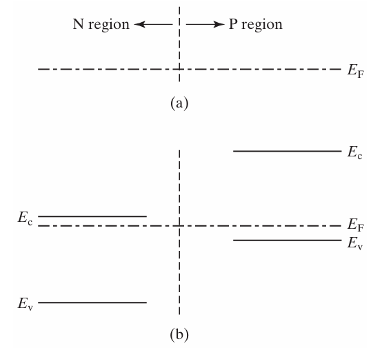
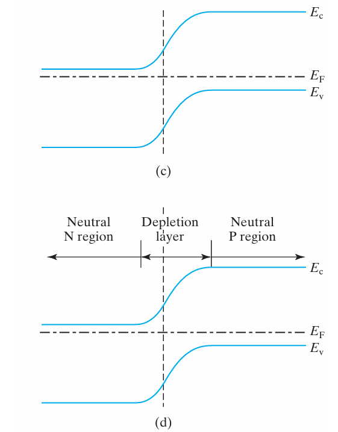
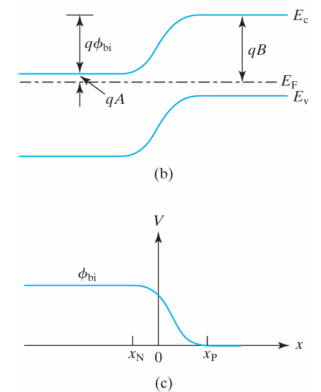
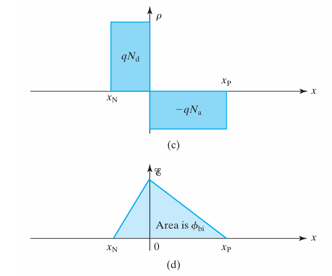
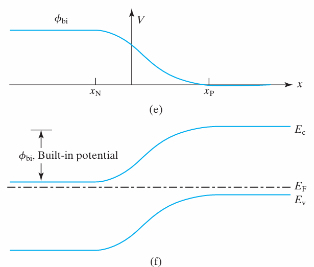
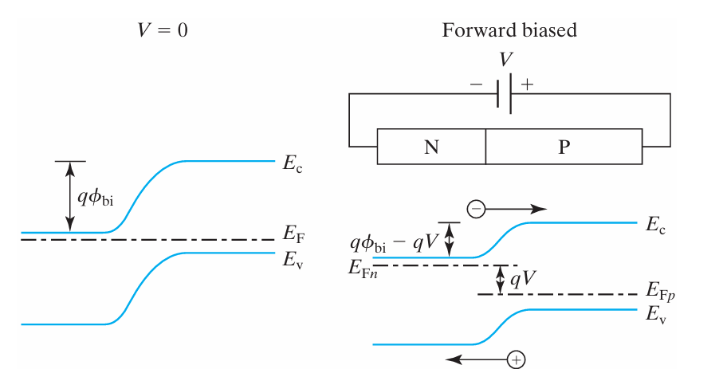
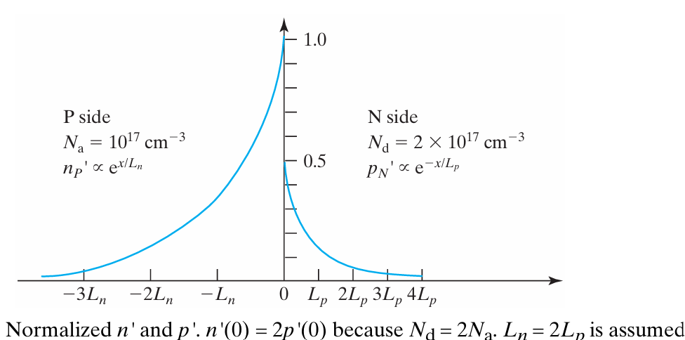

# Quasi-Equilibrium & Quasi-Fermi Levels

> 1. **核心思想**：非热平衡下 $np \neq n_i^2$，单一费米能级 $E_F$ 失效。准费米能级（$E_{Fn}, E_{Fp}$）仍然统一**电场漂移**与**浓度扩散**。
> 2. 此时有`excess carrier concentration`，假设满足小注入条件，即过剩载流子相比多子可以忽略不计

## why“准”平衡？

非热平衡状态（外加电压或光照）下，系统内部存在两种**数量级相差极大的微观弛豫时间**：

1. 外界引入`excess carriers` $n' , p'$
2. **带内弛豫极快** 飞秒级
   电子与电子之间、空穴与空穴通过频繁的热碰撞交换能量极快。**导带内的所有电子自己达成了热平衡**，**价带内的所有空穴自己也达成了热平衡**
   $$E_{fn} - E_f = \frac{kT}{q} ln(\frac{n_0 + n'}{n_0}) \qquad E_f - E_{fp} = \frac{kT}{q} ln(\frac{p_0 + p'}{p_0})$$
   $np = n_0p_0 \Rightarrow E_{fn} = E_{fp} = E_f$ , Specially if $E_f = E_i\qquad n = p = n_i$
3. **带间复合极慢** 微秒级
   导带电子跨越禁带与价带空穴复合的速度相对极慢，`excess carriers`维持一定量，无法消失，同时 $G \neq R$ ,系统不满足热平衡，有*外力*维持`excess carriers`

> **结论**：导带和价带各自内部达到了热平衡，但两带之间未平衡，这种状态称为**准平衡状态（Quasi-Equilibrium）**。

---
## Quasi-Fermi Level属于“谁”？

属于**carrier和band**，而非area
* **$E_{Fn}(x)$（电子准费米能级）**：描述全器件中**导带电子**的电化学势。
* **$E_{Fp}(x)$（空穴准费米能级）**：描述全器件中**价带空穴**(或者价带电子)的电化学势。
* **物理事实**：PN 结的任意位置 $x$（无论是 P 区、N 区还是耗尽区），**都同时存在 $E_{Fn}(x)$ 和 $E_{Fp}(x)$**。

**空穴占据概率公式**
$$f_p(E) = 1 - f(E) = \frac{1}{e^{(E_{Fp} - E)/kT} + 1}$$
玻尔兹曼近似
$$f_p(E) = e^{-(E_{Fp} - E)/kT}$$

## Quasi-Fermi Level平直

### 耗尽区
Let us assume that $E_{fn}$ remains constant through $x_P$ because the depletion layer is narrow.

### 中性区：多子锁定
在小注入条件下，即`excess carrier concentration` is negligible compared to $n_0 p_0$
所以，即使在非平衡下，若完全电离，多子浓度仍然近似等于掺杂浓度（$n \approx N_d$ 或 $p \approx N_a$）
* **N 区中性区**：$n \approx N_d \implies (E_c - E_{Fn}) = kT \ln \frac{N_c}{N_d} = \text{常数}$。
* **P 区中性区**：$p \approx N_a \implies (E_{Fp} - E_v) = kT \ln \frac{N_v}{N_a} = \text{常数}$。

> 在低注入中性区，**多子准费米能级与 $E_c, E_v$ 绑定为硬木板整体平移**，两者相对位置死死锁定，绝不相对移动.

当PN结两端施加`forward bias` $V$ 时，**P neutral**的 $E_c , E_v$ 相对 **N neutral** 抬升 $qV$.由于 `majority carrier`的 Quasi-fermi level 与该区band绑定，所以两费米能级差距可知
$$\boxed{E_{fp} - E_{fn} = qV}$$

---

## 为何费米能级是化学势

传统的电流密度由两项组成：漂移电流(电场拉扯) + 扩散电流(浓度挤压)
$$J_n = q n \mu_n \mathcal{E} + q D_n \nabla n$$

代入`非平衡电子浓度公式` $n(x) = n_i e^{(E_{Fn} - E_i)/kT}$  and `einstein relation` $D_n = \mu_n \frac{kT}{q}$ 化简，发现**漂移与扩散两项合并为单项**：

$$\boxed{J_n = \mu_n n \nabla E_{Fn}}$$
$$\boxed{J_p = \mu_p p \nabla E_{Fp}}$$

> **物理本质**：
> 1. **准费米能级的梯度 $\nabla E_F$ 是推动总电流的唯一真正热力学驱动力**（包含了电势能与化学势能）。
> 2. 若某区域 $\nabla E_{Fn} = 0$，则该区域电子的**净电流严格为零**（漂移与扩散完美抵消）。

|  |Thermal Equilibrium| Non-Equilibrium |
| :--- | :--- | :--- |
| **费米能级关系** | 统一：$E_{Fn}(x) = E_{Fp}(x) = E_F$ | 两带分裂：$E_{Fn}(x) \neq E_{Fp}(x)$ |
| **$np$** | 严格等于常数：$np = n_i^2$ | 偏离平衡：$np = n_i^2 e^{(E_{Fn} - E_{Fp})/kT}$ |

$E_{Fn} - E_{Fp}$ 直接量化了系统偏离热平衡的程度

# Poisson's Equation
- Derived from `Gauss's law`

$$\boxed{\frac{d^2V}{{dx}^2} = -\frac{\rho}{\epsilon_s}}$$

# PN junction band diagram
We use a `simplified model` : **step junction / abrupt junction**
The depletion layer is btw the p-side and n-side.

>At equilibrium or zero biased, only one horizon fermi level

|Intermediate steps of a PN junction |  The complete band diagram. |
|---|---|
|||

---

## why depletion?
The term depletion layer means that the layer is **depleted of electrons and holes**, (bcs holes **diffuse** from p-side to n-side, and similarly electrons).
- Results

>1. `Mobile carriers in dep` are way poor compared to `majority carriers in neutral`. 
>2. The ionized dopants ${N_a}^-$ near p-side, ${N}_d^+$ near n-side are no longer compensated by mobile carriers.
>3. This results in a **net space charge** in the depletion region, which creates a `built-in electric field` opposite to the `diffusion current`.

## built-in potential
- `built-in potential`定义为**热平衡下** N区与P区的电势差，即 $V_{bi} = \phi_n - \phi_p$, 是温度和doping决定的固有属性，不受外界影响

### 一、电流平衡推导
$$J_p = q p \mu_p \mathcal{E} + q D_p \nabla p$$
这里以空穴为例子, 在热平衡状态下，$J_p = \mu_p p \nabla E_{Fp} = 0$

- 引入电势与爱因斯坦关系式

根据`Einstein relationship`，迁移率和扩散系数满足
$$\frac{D_p}{\mu_p} = \frac{k_B T}{q} = V_t$$
（其中 $V_t$ 为热电压，常温下约等于 $26\text{ mV}$，$k_B$ 为玻尔兹曼常数，$T$ 为绝对温度）。
$$\mathcal{E}(x) = -\frac{d\phi(x)}{dx}$$
将上述两个关系代入平衡方程
$$q \mu_p p    (-\frac{d\phi}{dx}   ) - q D_p \frac{dp}{dx} = 0$$

$$-\frac{d\phi}{dx} = \frac{D_p}{\mu_p} \frac{1}{p} \frac{dp}{dx}$$
$$-d\phi = V_t \frac{dp}{p}$$

在PN结的空间电荷区两端进行积分：
1. 在P区边界（$x = -x_p$），电势为 $\phi_p$，多子hole浓度 $p_p \approx N_A$
2. 在N区边界（$x = x_n$），电势为 $\phi_n$，少子hole浓度 $p_n \approx \frac{n_i^2}{N_D}$（其中 $n_i$ 为本征载流子浓度，$N_D$ 为施主掺杂浓度）

$$\int_{\phi_p}^{\phi_n} -d\phi = V_t \int_{p_p}^{p_n} \frac{1}{p} dp$$
$$-(\phi_n - \phi_p) = V_t \ln   (\frac{p_n}{p_p}   )$$
$$V_{bi} = V_t \ln   (\frac{p_p}{p_n}   )$$

- 代入掺杂浓度
$p_p \approx N_A \qquad p_n \approx \frac{n_i^2}{N_D}$ 
$$V_{bi} = V_t \ln{\frac{N_A}{\frac{n_i^2}{N_D}}} = V_t \ln{\frac{N_A N_D}{n_i^2}}$$

$$\boxed{V_{bi} = \frac{k_B T}{q} \ln{\frac{N_A N_D}{n_i^2}}}$$
>从微观机制的角度

### 二、能带推导
$$N_c \exp   (-\frac{E_{cN} - E_f}{k_B T}   ) = N_D \qquad \text{N-region}$$
$$N_c \exp   (-\frac{E_{cP} - E_f}{k_B T}   ) = \frac{n_i^2}{N_A} \qquad \text{P-region}$$
$$V_{bi} = \frac{k_B T}{q} \ln{\frac{N_A N_D}{n_i^2}}$$
>从宏观

---

## Field and Potential in Depletion Layer 

>N on Left, P on Right
$$
\rho(x) = 
\begin{cases} 
0, & x < -x_n \quad \text{(neutral N)} \newline
+q N_d, & -x_n \le x < 0 \quad \text{(N区耗尽层，电荷来自 donor ion)} \newline
-q N_a, & 0 < x \le x_p \quad \text{(P区耗尽层，电荷来自 acceptor ion)} \newline
0, & x > x_p \quad \text{(neutral P)}
\end{cases}
$$

###  $\mathcal{E}(x)$ 的推导
> 泊松方程 + Boundary condition $E(-x_n) = E(x_p) = 0$

- **$-x_n \le x < 0$**

$\frac{d\mathcal{E}}{dx} = \frac{q N_d}{\epsilon}$，利用边界条件 $E(-x_n) = 0$：
$$
\mathcal{E}(x) = \int_{-x_n}^{x} \frac{q N_d}{\epsilon} dx' = \frac{q N_d}{\epsilon} (x + x_n)
$$

- **$0 < x \le x_p$**

$\frac{d\mathcal{E}}{dx} = -\frac{q N_a}{\epsilon}$，利用**边界条件** $E(x_p) = 0$：
$$
\mathcal{E}(x) = -\int_{x}^{x_p}    (-\frac{q N_a}{\epsilon}   ) dx' = \frac{q N_a}{\epsilon} (x_p - x)
$$

- **边界条件**
$$
\mathcal{E}(0^-) = \frac{q N_d x_n}{\epsilon}\qquad\mathcal{E}(0^+) = \frac{q N_a x_p}{\epsilon}
$$
所以 $N_d x_n = N_a x_p$ ，电场连续碰巧也是**电中性条件**

电场在 $x=0$ 处取得最大值（指向 $+x$ 方向，即从 N 区指向 P 区）
$$
\mathcal{E}_{max} = E(0) = \frac{q N_d x_n}{\epsilon} = \frac{q N_a x_p}{\epsilon}
$$

###  $V(x)$ 的推导

$$
\mathcal{E}(x) = -\frac{dV(x)}{dx} \implies V(x) = -\int E(x) dx
$$

> **参考电势设置**：习惯上设 P 区中性区的电势为零点，即 $V(x_p) = 0$。

- **P 区耗尽层（$0 < x \le x_p$）**
$$
V(x_p) - V(x) = -\int_{x}^{x_p} E(x') dx' \implies V(x) = \int_{x}^{x_p} \frac{q N_a}{\epsilon} (x_p - x') dx'
$$
$$
V(x) = \frac{q N_a}{2\epsilon} (x_p - x)^2
$$
在交界面 $x = 0$ 处的电势为：
$$
V(0) = \frac{q N_a}{2\epsilon} x_p^2
$$

- **N 区耗尽层（$-x_n \le x < 0$）**
$$
V(0) - V(x) = -\int_{x}^{0} E(x') dx' \implies V(x) = V(0) + \int_{x}^{0} \frac{q N_d}{\epsilon} (x' + x_n) dx'
$$
$$
V(x) = \frac{q N_a}{2\epsilon} x_p^2 + \frac{q N_d}{\epsilon}    ( -x_n x - \frac{x^2}{2}    )
$$

### $V_{bi} , V_b$ 与width $W$

- **Potential barrier** $V_b = V(-x_n) - V(x_p)$

$$
V_b = \frac{q N_a}{2\epsilon} x_p^2 + \frac{q N_d}{2\epsilon} x_n^2
$$

利用电中性条件 $x_p = \frac{N_d}{N_a} x_n$，可将 $V_b$ 简化为仅由 $x_n$ 或 $x_p$ 表示：
$$
\boxed{V_b = \frac{q}{2\epsilon} \frac{N_d (N_a + N_d)}{N_a} x_n^2}
$$
$$
x_n = \sqrt{\frac{2\epsilon V_b}{q} \frac{N_a}{N_d(N_a + N_d)}}\qquad x_p = \sqrt{\frac{2\epsilon V_b}{q} \frac{N_d}{N_a(N_a + N_d)}}
$$
$$
W = x_p + x_n = \sqrt{\frac{2\epsilon V_b}{q}    ( \frac{1}{N_a} + \frac{1}{N_d}    )}
$$

由此可以得到 **width** 与 **potential barrier**的关系
- 能带角度 
$$V_b = \frac{E_{cP} - E_{cN}}{q} = V_{bi} + V_r$$
其中 $V_r$是外界加在PN结两端的电压，规定正方向是`reverse biased`.

$$\boxed{W =  \sqrt{\frac{2\epsilon V_b}{q N}}}\qquad  \frac{1}{N} = \frac{1}{N_a} + \frac{1}{N_d}$$ 

|Charge and field|potential and energy band|
|---|---|
| ||

---
# reverse bias
## Capacitance
**Reverse bias**下，在不考虑极少量的`excess minority carriers`情况下，耗尽区近似绝缘，忽略反向电流，具有电容性。

此处的电容定义是微分电容$C = \frac{dQ}{dV}$,电容不是定值，会随着电压变化。下面的结论类似平行板电容

$$C_{dep} = \frac{\epsilon_s A}{W_{dep}}$$

## Junction breakdown
>1. A reverse-biased PN junction conducts negligibly small current. This is true until a critical reverse bias is reached and junction breakdown occurs.
>2. **击穿因为电场强度**
   Junction breakdown occurs when the peak electric field in the PN junction reaches a critical value when the valence electrons are prone to `impact ionization` or can be `emitted by the field`.

### Peak electric field
field and `potential barrier`
$$
\mathcal{E}_{max} = E(0) = \frac{q N_d x_n}{\epsilon}\qquad V_b = \frac{q}{2\epsilon} \frac{N_d (N_a + N_d)}{N_a} x_n^2
$$
When $\mathcal{E}_{max}$ reaches some critical value, $\mathcal{E}_{crit}$, 外加的`breakdown voltage` can be calculated
$$ V_{break}  = \frac{\epsilon \cdot\mathcal{E}_{crit}^2}{2qN} - V_{bi}$$

---

# forward bias 

**这节将推导 the concentration of `excess minority carriers` in `neutral region` under forward bias**. To conclude the concentration, we need `quasi-equilibrium boundary condition` and `Continuity equation`.

>**carrier injection**
就是一方的`majority carrier`越过势垒，扩散到对方区域，成为对方区域的`excess minority carrier`的过程

>**微观机理**：a forward bias of V reduces the barrier height, thus reduces $\mathcal{E}$ and upsets the balance between diffusion and drift that exists at zero bias. Electrons can now diffuse from the N side into the P side. Similarly, holes are injected from the P side into the N side.

## quasi-equilibrium boundary condition
- 在depletion layer，我们有`肖克利假设`：由于depletion layer极窄且几乎没有载流子，所以载流子通过时间极短，远远小于 $\tau$ ，所以耗尽层内不考虑`recombination`

- 在中性区，不能忽略`recombination`,所以不能直接使用这节推出的东西，需要考虑[连续性方程](#continuity-equation)

- 在中性区和depletion layer的边界，由于多子浓度一致，且可以使用`肖克利假设`，所以下面很容易算出少子浓度，边界处的浓度可以作为`boundary condition of continuity equation`

On the N side, $ E_c - E_{Fn}$ is of course determined by $ N_d $ .

On the P side,  $$N_c e^{-(E_c - E_{Fp})/kT} = n_{p0} $$

Check [Predetails](#中性区多子锁定) to understand why. Then

$$
n(x_p) = N_c e^{-(E_c - E_{Fn})/kT} 
= N_c e^{-(E_c - E_{Fp})/kT} e^{(E_{Fn} - E_{Fp})/kT}
$$

$$
= n_{p0} e^{(E_{Fn} - E_{Fp})/kT} = n_{p0} e^{qV/kT} 
$$

$ n_{p0} $ is the **equilibrium** `denoted by subscript 0` electron concentration of the **P region** `denoted by the subscript P`, simply $ n_i^2/N_a $. The `minority carrier density` has been raised by $ e^{qV/kT} $.

A similar equation may be derived for $ p(x_N) $ .Now we concluded **quasi-equilibrium boundary condition** or the **Shockley boundary condition**.

$$
\boxed{
\begin{aligned}
   n(x_p) = n_{p0} e^{qV/kT} &= \frac{n_i^2}{N_a} e^{qV/kT} \\
   p(x_N) = p_{N0} e^{qV/kT} &= \frac{n_i^2}{N_d} e^{qV/kT}
\end{aligned}
}
$$

- excess minority carrier on boundary
$$
\boxed{
\begin{aligned}
   n'(x_p) = n(x_p) - n_{p0}  &= \frac{n_i^2}{N_a} (e^{qV/kT} - 1)\\
   p'(x_N) = p(x_N) - p_{N0}  &= \frac{n_i^2}{N_d} (e^{qV/kT} - 1)
\end{aligned}
}
$$

---

## Continuity equation

>To determine the minority carrier densities in the interiors of the neutral N and P regions

In steady state, the number of holes flowing into the box per second = number of holes flowing out of the box per second + number of holes recombining in the box per second

$$
\frac{dJ_p}{dx} = q \frac{p'}{\tau} 
$$
$p'$ is `excess hole concentration`, τ is the `recombination lifetime` of the carriers.
This equation is valid for **both the majority and minority** carriers. 
### negligible drift component
>It is easy to apply the formula above to the minority carriers, bcs the **minority carrier current** is **dominated by diffusion** and the drift component can be ignored.

Take hole current for explanation
$$J_p = -qD_p\frac{dp}{dx} + q\mu_p p\mathcal{E}$$
- *For* minority, $p$ is small, $\mathcal{E}$ is negligible in neutral area, $\nabla p$ is huge.
- *For* majority, $p = N_a$, drift component **cannot be ignored**.  

### excess carriers contributes to net recombination
>Under equilibirum, the generation and recombination of carriers are at dynamic balance. When the balace is borken, only the **Net Recombination** is to be figured out.

1. **at eq**

No voltage applied, no light. In the semiconductor, the carriers generate and recombine.
- `Thermal Generation rate`, $G_0$: 热运动不断让电子脱离束缚，产生新的空穴。
- `Thermal Recombination rate`, $R_0$: 原有的空穴和电子相遇并消失。

There is a balance: $R_0 = G_0$

此时，虽然有空穴/电子在不断复合，但也有同等数量的空穴/电子在产生。因此，**整体上载流子的浓度保持恒定，电流不会发生任何变化**。

2. **non eq**

voltage applied, or light. Assume that hole concentration for now: $p = p_0 + p'$

由于空穴变多了，它们遇到电子并发生复合的概率也随之变大
* **net recombination rate** : $R = \frac{p}{\tau} = \frac{p_0 + p'}{\tau}$
* **thermal generation rate** $G_0$ 依然保持不变：$G_0 = \frac{p_0}{\tau}$

此时，单位时间内**净复合**的空穴数 $U$ 等于“总共复合的”减去“新产生的”：
$$U = R - G_0 = \frac{p_0 + p'}{\tau} - \frac{p_0}{\tau} = \frac{p'}{\tau}$$

### excess minority carrier concentration
$$ qD_p \frac{d^2p}{dx^2} = q \frac{p'}{\tau_p} $$
Derived from $\frac{dJ_p}{dx} = q \frac{p'}{\tau} \quad J_p = -qD_p\frac{dp}{dx}$ , ignoring the drift component.

$$
\boxed{\frac{d^2p'}{dx^2} = \frac{p'}{D_p \tau_p} = \frac{p'}{L_p^2} \qquad L_p \equiv \sqrt{D_p \tau_p}}
$$
$$
\boxed{\frac{d^2n'}{dx^2} = \frac{n'}{D_n \tau_n} = \frac{n'}{L_n^2} \qquad L_n \equiv \sqrt{D_n \tau_n}}
$$
$L_p , L_n$ are called diffusion lengths.
The minority carriers in the interior of neutral area by solving

$$
\frac{d^2 p'}{dx^2} = \frac{p'}{L_p^2}
$$

for the boundary conditions

$$
p'(\infty) = 0  \qquad p'(x_N) = p_{N0}(e^{qV/kT} - 1)
$$

The general solution

$$
p'(x) = Ae^{x/L_p} + Be^{-x/L_p}
$$

The first boundary condition demands \(A = 0\). The second determines \(B\) and leads to

$$
p'(x) = p_{N0}(e^{qV/kT} - 1)e^{-(x-x_N)/L_p}, \quad x > x_N
$$

Similarly, on the P side,

$$
n'(x) = n_{P0}(e^{qV/kT} - 1)e^{(x-x_P)/L_n}, \quad x < x_P
$$

From the depletion-layer edges, the injected minority carriers move outward by diffusion. As they diffuse, their densities are reduced due to recombination, thus creating the exponentially decaying density profiles. 

## ideal PN diode IV characteristics
**use the excess carrier concentration to find IV relationship under forward bias**

N side minority:
$$
J_{pN} = -qD_p \frac{dp'(x)}{dx} = q \frac{D_p}{L_p} p_{N0}(e^{qV/kT} - 1)e^{-(x - x_N)/L_p}
$$
P side minortiy:
$$
J_{nP} = qD_n \frac{dn'(x)}{dx} = q \frac{D_n}{L_n} n_{P0}(e^{qV/kT} - 1)e^{(x - x_P)/L_n}
$$

$$
J_{total} = J_{pN}(x_N) + J_{nP}(x_P) = ( q \frac{D_p}{L_p} p_{N0} + q \frac{D_n}{L_n} n_{P0} ) (e^{qV/kT} - 1)
$$
>1. in steady state, 空间处处电荷不积累，即 $J_{total}$ 与 $x$ 无关，找到一个合适的区域计算 $J_{total}$ 即可
>2. **`肖克利假设`**, 由于depletion layer极窄且几乎没有载流子，载流子通过时间极短，远远小于 $\tau$ ，所以耗尽层内不考虑`recombination`。我们认为在`depletion layer`内，$J_{p} \quad J_{n}$ 与位置 $x$ 无关，将边界处电流密度相加，计算`depletion layer`的电流密度

$$
\boxed{
\begin{aligned}
I &= I_0 (e^{qV/kT} - 1)\\
I_0 &= A q n_i^2    ( \frac{D_p}{L_p N_d} + \frac{D_n}{L_n N_a}    )
\end{aligned}
}
$$
### limits of ideal model
1. Avalanche Breakdown 
反向电压加得足够大，电场变强，进入耗尽区的少子在两次碰撞之间获得的动能足以击出价带中的电子，产生新的电子-空穴对。这被称为`Impact Ionization`，此时，耗尽区内的净产生率 $G_{impact} \gg 0$，原本的**肖克利假设（耗尽层内不考虑G和R）宣告失效**
2. Zener Breakdown 也违反`肖克利假设`

## contributions of depletion region
>contribution = generation + recombination

$J_{total} = J_{pN}(x_N) + J_{nP}(x_P)$ 的前提是`depletion region`没有`contribution`，即`schottky假设`，所以电流密度穿过空乏区不会改变

考虑空乏区内
$$pn = N_ve^{-\frac{E_{fp} - E_v}{kT}} \cdot N_ce^{-\frac{E_c - E_{fn}}{kT}} = N_cN_ve^{-\frac{E_c - E_v}{kT}}e^{-\frac{E_{fp} - E_{fn}}{kT}}$$

[考虑准费米能级的相对偏移](#中性区多子锁定), $E_{fp} - E_{fn} \equiv -qV$
$$pn = n_i^2 e^{{qV}/{kT}}$$
$n(x_p) = \frac{n_i^2}{N_a} e^{{qV}/{kT}}$是上式的special case,用到了 $p = N_a\quad n = N_d$

但是在`Space Charge Region`， neither is known.
当 $n =  p = n_ie^{{qV}/{2kT}}$ , `recombination rate`最大

Net recombination rate per unit volume = $$\frac{n_i}{\tau_{\text{dep}}}   (e^{{qV}/{2kT}} - 1   )$$

### net current & leakage current
$$
I = I_0    ( e^{{qV}/{kT}} - 1    ) + A \frac{qn_i W_{\text{dep}}}{\tau_{\text{dep}}}    ( e^{{qV}/{2kT}} - 1    ) 
$$

The second term is the SCR current. This **nonideal current** is responsible for the low gain of bipolar transistor at low current.
The reverse leakage current, under reverse bias, is

$$
I_{\text{leakage}} = I_0 + A \frac{qn_i W_{\text{dep}}}{\tau_{\text{dep}}} 
$$
>under reverse bias, leakage current raised. 
